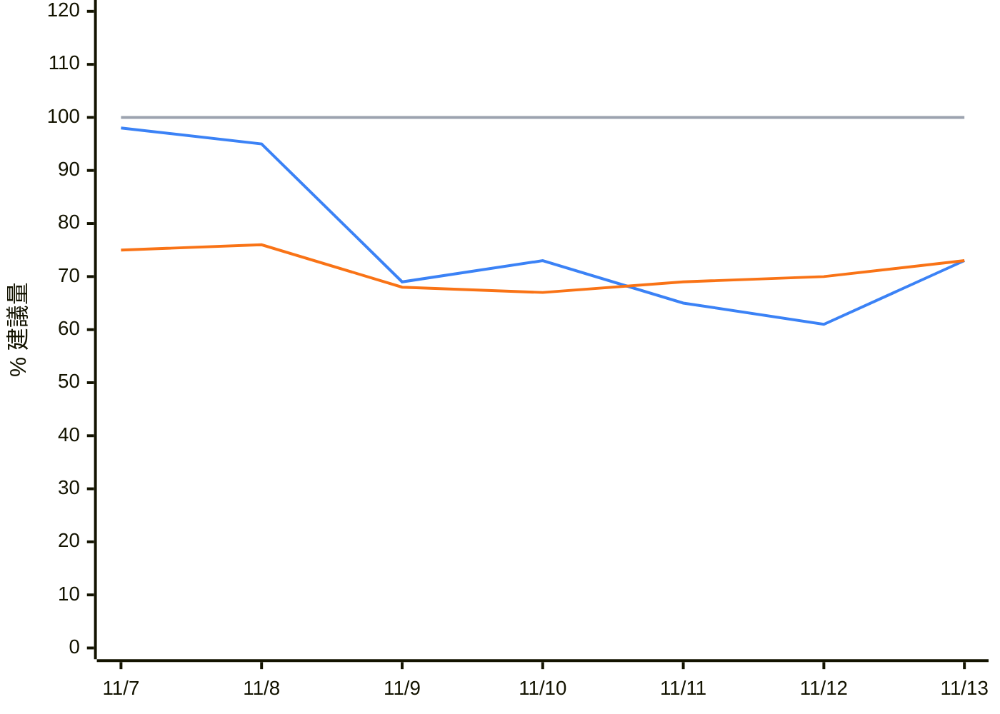

# 🐾 Mina & Lisa 飲食紀錄

> 最後更新：2026-11-14 21:58　·　皇家 K36 幼貓乾糧（1 g ≈ 4.08 kcal）　汪喵星球 純肉泥（1 g ≈ 0.86 kcal）
> 自動產生，不用手動改。完整紀錄（最近 14 天、體重、建議量算法）見 [飲食紀錄.md](飲食紀錄.md)。

## 📅 今天 2026/11/14（六）

| | Mina | Lisa |
|---|:-:|:-:|
| 年齡 | 5 個月 7 天 | 5 個月 7 天 |
| 體重 | 2.5 kg（11/2 量） | 2.5 kg（11/2 量） |
| **每日建議** | **319 kcal ≈ 78 g** | **319 kcal ≈ 78 g** |
| 今天已吃 | 58.1 g · 237 kcal | 63.1 g · 258 kcal |
| 進度 | 🟩🟩🟩🟩🟩🟩🟩⬜⬜⬜ 74% | 🟩🟩🟩🟩🟩🟩🟩🟩⬜⬜ 81% |
| 狀態 | **還可吃約 20 g** | **還可吃約 15 g** |

**今天每一餐**

| 時間 | Mina | Lisa | 備註 |
|---|--:|--:|---|
| 03:30 | 5 g | 5 g |  |
| 06:30 | 5.6 g | 5.6 g |  |
| 07:45 | 10 g | 10 g |  |
| 10:30 | 7.5 g | 5.3 g |  |
| 15:00 | 10 g | 10 g | 約略，忘記記 |
| 18:00 | 0 g | 7.2 g | 沒吃 |
| 21:00 | 10 g | 10 g |  |
| 22:00 | 10 g | 10 g |  |

## 📉 最近 7 天：吃了建議量的幾 %

🟦 Mina　🟧 Lisa　⬜ 建議量 100%

| 日期 | Mina | Lisa |
|---|--:|--:|
| 11/13（五） | 56.7 g · 232 kcal · 73% | 57.4 g · 234 kcal · 73% |
| 11/12（四） | 47.9 g · 196 kcal · 61% | 54.5 g · 223 kcal · 70% |
| 11/11（三） | 50.4 g · 206 kcal · 65% | 54 g · 220 kcal · 69% |
| 11/10（二） | 56.5 g + 肉泥 3 g · 233 kcal · 73% | 52 g + 肉泥 3 g · 215 kcal · 67% |
| 11/9（一） | 54 g · 220 kcal · 69% | 53.5 g · 218 kcal · 68% |
| 11/8（日） | 73.2 g + 肉泥 3 g · 301 kcal · 95% | 59 g + 肉泥 3 g · 243 kcal · 76% |
| 11/7（六） | 75.7 g + 肉泥 3 g · 312 kcal · 98% | 57.8 g + 肉泥 3 g · 239 kcal · 75% |
