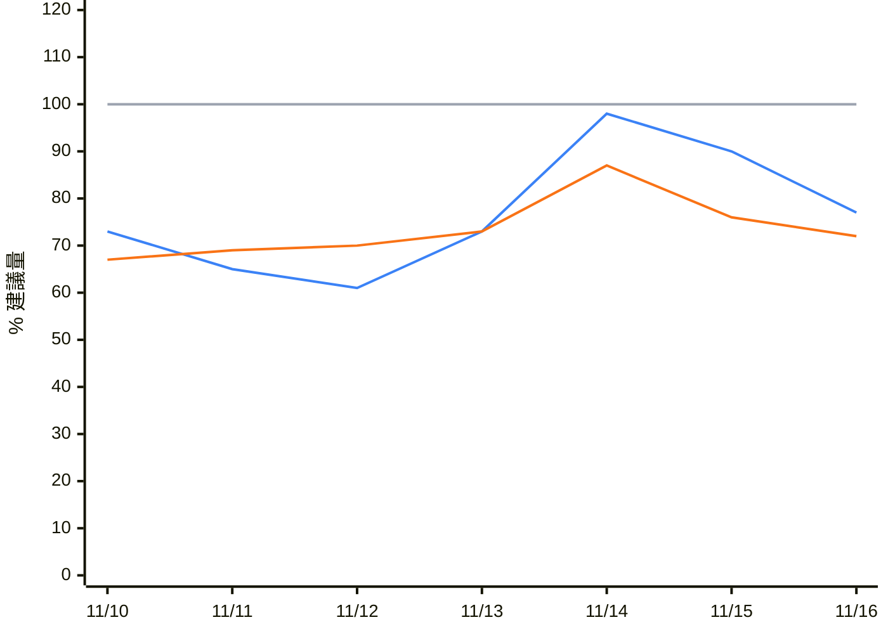

# 🐾 Mina & Lisa 飲食紀錄

> 最後更新：2026-11-17 23:14　·　皇家 K36 幼貓乾糧（1 g ≈ 4.08 kcal）　汪喵星球 純肉泥（1 g ≈ 0.86 kcal）　雞肉凍乾（1 g ≈ 5.01 kcal）
> 自動產生，不用手動改。完整紀錄（最近 14 天、體重、建議量算法）見 [飲食紀錄.md](飲食紀錄.md)。

## 📅 今天 2026/11/17（二）

| | Mina | Lisa |
|---|:-:|:-:|
| 年齡 | 5 個月 10 天 | 5 個月 10 天 |
| 體重 | 2.5 kg（11/2 量） | 2.5 kg（11/2 量） |
| **每日建議** | **319 kcal ≈ 78 g** | **319 kcal ≈ 78 g** |
| 今天已吃 | 61.6 g + 肉泥 3 g + 凍乾 2 g · 264 kcal | 53.6 g + 肉泥 3 g + 凍乾 2 g · 231 kcal |
| 進度 | 🟩🟩🟩🟩🟩🟩🟩🟩⬜⬜ 83% | 🟩🟩🟩🟩🟩🟩🟩⬜⬜⬜ 73% |
| 狀態 | **還可吃約 13 g** | **還可吃約 21 g** |

**今天每一餐**

| 時間 | Mina | Lisa | 備註 |
|---|--:|--:|---|
| 05:30 | 5 g | 5 g |  |
| 07:00 | 10 g | 7 g |  |
| 09:00 | 7.1 g | 6.5 g |  |
| 10:30 | 10 g | 7.9 g |  |
| 13:45 | 9.2 g | 8.3 g |  |
| 15:30 | 3 g | 1.6 g |  |
| 19:00 | 8.8 g | 7.9 g |  |
| 21:00 | 8.5 g | 9.4 g |  |
| 23:14 | 肉泥 3 g + 凍乾 2 g | 肉泥 3 g + 凍乾 2 g |  |

## 📉 最近 7 天：吃了建議量的幾 %

🟦 Mina　🟧 Lisa　⬜ 建議量 100%

| 日期 | Mina | Lisa |
|---|--:|--:|
| 11/16（一） | 57.3 g + 肉泥 3 g + 凍乾 2 g · 247 kcal · 77% | 53.3 g + 肉泥 3 g + 凍乾 2 g · 230 kcal · 72% |
| 11/15（日） | 67.3 g + 肉泥 3 g + 凍乾 2 g · 287 kcal · 90% | 55.9 g + 肉泥 3 g + 凍乾 2 g · 241 kcal · 76% |
| 11/14（六） | 72.9 g + 肉泥 3 g + 凍乾 2.5 g · 313 kcal · 98% | 64.6 g + 肉泥 3 g + 凍乾 2.5 g · 279 kcal · 87% |
| 11/13（五） | 56.7 g · 232 kcal · 73% | 57.4 g · 234 kcal · 73% |
| 11/12（四） | 47.9 g · 196 kcal · 61% | 54.5 g · 223 kcal · 70% |
| 11/11（三） | 50.4 g · 206 kcal · 65% | 54 g · 220 kcal · 69% |
| 11/10（二） | 56.5 g + 肉泥 3 g · 233 kcal · 73% | 52 g + 肉泥 3 g · 215 kcal · 67% |
